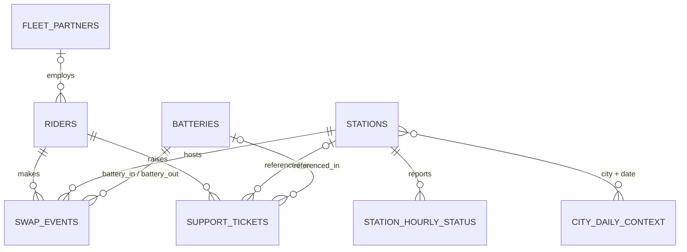

# ⚡ VoltRelay Energy: Battery-Swap Network Analytics

> Data Analytics Hackathon by **Gradient Learnings**: an open, evidence-based investigation into service quality, retention, and profitability on a simulated EV battery-swapping network in India.

---

## Table of Contents

- [About the Dataset](#about-the-dataset)
- [Business Background](#business-background)
- [The Business Challenge](#the-business-challenge)
- [Role and Objective](#role-and-objective)
- [Core Questions](#core-questions)
- [Optional Deep-Dive Questions](#optional-deep-dive-questions)
- [Expected Outcome](#expected-outcome)
- [Deliverables](#deliverables)
- [Dataset Overview](#dataset-overview)
- [Data Dictionary](#data-dictionary)
- [Data Relationships](#data-relationships)
- [Data Quality Notes](#data-quality-notes)
- [Notes on Using This Dataset](#notes-on-using-this-dataset)
- [Repository Structure](#repository-structure)

---

## About the Dataset

This hackathon uses a **synthetic dataset**, not a scraped or purchased one: approximately **3.9 million swap events** from a simulated battery-swapping network for electric two- and three-wheelers, operating across **six Indian cities** between **January 2024 and June 2025**.

The data was generated with a seeded, reproducible **discrete-event simulation** (not sampled column by column). Station capacity, battery degradation, thermal charging behavior, pricing response, and rider churn all emerge from the same underlying mechanics and are mutually consistent, the way a real company's operational data would be.

| Item | Detail |
|---|---|
| **Source / license** | Synthetic data generated for the Gradient Learnings Data Analytics Hackathon. Free for use within the hackathon; no external license applies since no real company or personal data is involved. |
| **Fictional entities** | VoltRelay Energy, ZipDrop, RapidCell, and all fleet partners |
| **Generation seed** | `59500` |
| **Dataset link** | _Add link here_ |

---

## Business Background

**VoltRelay Energy** runs a battery-swapping network for electric two-wheelers (2W) and three-wheelers (3W) across six cities:

**Bengaluru · Delhi NCR · Hyderabad · Pune · Mumbai · Jaipur**

Its customers are gig and logistics riders (food delivery, quick commerce, e-commerce logistics, cargo, and bike-taxi) who cannot afford to stop and charge for hours. A rider pulls up to an unmanned swap cabinet at a kirana store, fuel pump, or mall parking lot, inserts a depleted battery pack, and receives a charged one in about two minutes.

- Riders pay **per swap** or through a **prepaid pack**.
- **Fleet-affiliated riders** are billed to their employer at a contracted discount.

---

## The Business Challenge

VoltRelay has roughly 18 months of operational history (Jan 2024 to Jun 2025) covering every swap attempt, hourly station telemetry, battery lifecycle data, support tickets, fleet partner contracts, and daily weather and calendar context across all six cities.

During this period VoltRelay:

- expanded its station network in **two waves**
- changed its **base pricing**
- piloted **peak/off-peak pricing** in two cities
- brought on a **new battery supplier**
- **renegotiated** its largest fleet contract

Completed swaps and revenue grew substantially, but **service failures rose faster, new-rider retention fell, and per-swap profitability eroded**. No single, consolidated analysis has connected these threads. Leadership wants to understand what is actually driving these outcomes before committing its next operating budget.

---

## Role and Objective

**Your role:** Data Analyst supporting VoltRelay's operations and customer experience teams.

**Objective:** Determine how the network has performed over time, what factors are associated with **service failures, rider churn, and eroding margins**, where performance varies most across stations, geography, equipment, and partner segment, and what VoltRelay should prioritize as a result. Use evidence from the data rather than assumptions. No answer is provided; that is for you to find.

---

## Core Questions

Focus the primary analysis on these six questions. Together they should form the main analytical story.

1. **Network Performance Over Time**
   How have completed swaps, revenue, failure rates, and contribution margin per swap trended? Do they all tell the same story, or do some metrics move in different directions?

2. **Service Failures and Customer Experience**
   How do queue wait time, failed attempts, and abandoned swaps relate to station, hour of day, season, and vehicle class? Is service quality spread evenly across the network, or concentrated somewhere specific?

3. **Station and Geographic Patterns**
   Stations differ in charger generation, location type, and commissioning date, and are not evenly distributed across cities. How do these differences relate to service performance, battery turnaround time, or customer complaints?

4. **Battery and Equipment Performance**
   How does battery health (state of health, charge cycles, supplier, manufacturing lot) relate to delivered range and swap frequency? Do any equipment or supplier cohorts stand out?

5. **Pricing and Partner Economics**
   How do the base price change, the peak/off-peak pricing pilot, and individual fleet partner contract terms relate to swap timing, revenue, and contribution margin? Do they affect every rider segment the same way?

6. **Root Cause Analysis of Retention**
   Identify the most important factors associated with new riders not returning. Distinguish **primary drivers** from **secondary or contributing** factors. You are not expected to prove a single cause; more than one factor likely contributes.

---

## Optional Deep-Dive Questions

Not required. These are additional analytical directions if time allows.

- **The Budget Decision:** Internal teams proposed four uses for the next operating budget: more stations, more batteries, a network-wide pricing rollout, and a long-term exclusive with the largest fleet partner. Which does the evidence support, and what would you recommend instead or in addition?
- **Expansion Wave Effectiveness:** Did the two expansion waves improve service where riders needed it, or mainly where sites were easiest to open? Network-wide averages and the busiest stations may not tell the same story.
- **Fleet Partner Value:** Do partners differ in contribution margin once energy, battery wear, and station costs are included? Is the largest partner also the most valuable?
- **Support Ticket Text (Advanced):** Does the free-text comment (English and Hinglish) add anything beyond the structured category and resolution fields?
- **Anomalies:** Are there stations, battery cohorts, or time windows that stand out (extreme failure rates, unusual degradation, firmware- or connectivity-linked irregularities)?

---

## Expected Outcome

A clear, evidence-based picture of:

1. How the network is actually performing.
2. Which factors are associated with service failures, churn, and margin erosion, and which look like **primary drivers** versus **secondary contributors**.
3. What VoltRelay should prioritize to improve the platform as it grows.

Causation cannot be proven from observational data. A well-reasoned, well-evidenced case for what is likely going on is what a strong submission looks like.

### Skill levels

| Level | Suggested techniques |
|---|---|
| **Beginner** | Data cleaning, KPI calculation, EDA, straightforward visualizations |
| **Intermediate** | Multi-table joins, segmentation by station/city/equipment, time-trend analysis |
| **Advanced** | Statistical testing, difference-in-differences for the pricing pilot, cohort/retention curves, ticket text analysis |

There is no minimum technique requirement. A focused answer to the six Core Questions is a complete and competitive submission.

---

## Deliverables

1. **Google Colab Notebook**: Data Understanding, Data Cleaning, EDA, Analysis (Core Questions plus any chosen deep-dives), Visualizations, and Key Findings. Must run top to bottom without errors.
2. **Analysis Report**: Problem Understanding, Analytical Approach, Key Insights, Supporting Visualizations, Business Findings, and Actionable Recommendations.
3. **Three-Minute Video**: In this order: the business problem, the analytical approach, the most important insight(s), and recommendations, presented to VoltRelay's operations and customer experience leadership.

---

## Dataset Overview

Eight related CSV files (two gzip-compressed) covering swap activity from January 2024 to June 2025. There is **no target or label column**; this is an open analytics challenge, not a prediction task.

| File | Rows | Grain |
|---|---:|---|
| `swap_events.csv.gz` | 3,877,013 | 1 row per swap attempt (completed or not) |
| `station_hourly_status.csv.gz` | 1,487,712 | 1 row per station per hour |
| `riders.csv` | 20,000 | 1 row per registered rider |
| `batteries.csv` | 6,500 | 1 row per battery pack |
| `support_tickets.csv` | 44,000 | 1 row per customer support ticket |
| `stations.csv` | 152 | 1 row per swap station |
| `city_daily_context.csv` | 3,282 | 1 row per city per day |
| `fleet_partners.csv` | 12 | 1 row per B2B fleet customer |

| File | Purpose | Primary key | Foreign keys |
|---|---|---|---|
| `swap_events` | Core fact table: every swap attempt with pricing, battery, and timing detail (22 columns, Jan 1 2024 to Jun 30 2025) | `event_id` | `rider_id`, `station_id`, `battery_in_id`, `battery_out_id` |
| `station_hourly_status` | Hourly cabinet telemetry: charged stock, throughput, temperature, outages (13 columns) | `station_id` + `hour_start` | `station_id` |
| `riders` | Rider profile and acquisition data (12 columns) | `rider_id` | `partner_id` (blank for independents) |
| `batteries` | Physical asset ledger: supplier, lot, health (13 columns) | `battery_id` | none |
| `support_tickets` | Complaints via app, call center, WhatsApp, partner escalation (12 columns) | `ticket_id` | `rider_id`, `station_id` (optional), `battery_id` (optional) |
| `stations` | Station attributes, equipment generation, expansion timing (21 columns) | `station_id` | none |
| `city_daily_context` | Daily weather, calendar, competitive context per city | `city` + `date` | joins by city and date |
| `fleet_partners` | Contract terms for B2B fleet customers | `partner_id` | none |

---

## Data Dictionary

<details>
<summary><b>swap_events.csv.gz</b> (core fact table)</summary>

| Column | Type | Description |
|---|---|---|
| `event_id` | string (PK) | Unique event identifier |
| `rider_id` | string (FK) | Rider making the attempt |
| `station_id` | string (FK) | Station where the attempt occurred |
| `event_ts` | datetime | When the attempt occurred |
| `event_type` | string | `swap_completed` / `failed_no_charged_battery` / `abandoned_queue` / `cancelled_by_rider` / `failed_system_error` |
| `attempt_seq` | int | Always 1 in this export (reserved) |
| `queue_wait_sec` | int | Seconds from arrival to swap completion or exit (congestion measure) |
| `battery_in_id` | string, often missing | Battery the rider returned; missing when no pack was inserted |
| `battery_out_id` | string, missing unless completed | Battery the rider received |
| `soc_in_pct` / `soh_in_pct` | float | State of charge / health of the returned pack; missing unless a pack was inserted |
| `soc_out_pct` / `soh_out_pct` | float | State of charge / health of the issued pack; missing unless completed |
| `km_since_last_swap` | float | Distance on the returned pack since its previous swap (effective range proxy); some missing or invalid, includes odometer-reset outliers |
| `tariff_code` | string | `STD` / `PEAK` / `OFFPEAK` / `PREPAID` / `PARTNER` / `PROMO_FREE` |
| `list_price_inr` | float | List price before discount or surcharge |
| `discount_inr` | float | Discount applied |
| `amount_charged_inr` | float | Net amount charged (revenue) |
| `payment_mode` | string | `upi` / `wallet` / `prepaid` / `partner_invoice` |
| `energy_to_recharge_kwh` | float | Grid energy drawn to recharge the returned pack; missing unless completed |
| `station_firmware` | string | Cabinet firmware version at the time of the event |
| `sync_mode` | string | `realtime` / `offline_batch` |

</details>

<details>
<summary><b>station_hourly_status.csv.gz</b></summary>

| Column | Type | Description |
|---|---|---|
| `station_id` | string (FK) | Station |
| `hour_start` | datetime | Start of the telemetry hour (PK with `station_id`) |
| `charged_2w_avg` / `charged_2w_min` | float / int | Average and minimum charged 2W packs available (stockout detection) |
| `charged_3w_min` | int | Minimum charged 3W packs; missing if no 3W slots or no telemetry |
| `packs_charging` | int | Packs charging at end of hour (throughput) |
| `packs_quarantined` | int | Packs pulled for thermal or fault reasons |
| `chargers_online` | int | Working charging slots |
| `ambient_temp_c` / `cabinet_temp_c` | float | Outside and internal cabinet temperature |
| `avg_charge_minutes` | float | Average charge duration for packs finishing that hour (turnaround) |
| `outage_minutes` | int | Minutes of power outage that hour |
| `grid_kwh` | float | Energy drawn from the grid that hour |
| `telemetry_status` | string | `ok` / `partial` / `missing` |

</details>

<details>
<summary><b>riders.csv</b></summary>

| Column | Type | Description |
|---|---|---|
| `rider_id` | string (PK) | Rider identifier |
| `partner_id` | string (FK) | Fleet partner; blank for independents |
| `vehicle_class` | string | `2W` / `3W` |
| `vehicle_model` | string | Correlates with fleet affiliation, not a mechanical cause on its own |
| `home_city` | string | Registered city; **inconsistent spellings, clean before use** |
| `home_zone` | string | Primary operating micro-market |
| `signup_date` | date | Registration date (cohort analysis) |
| `signup_channel` | string | `partner_onboarding` / `referral` / `app_store` / `field_agent` |
| `plan_type` | string | `pay_as_you_go` / `prepaid_pack` / `partner_billed` |
| `declared_shift` | string | Self-reported working hours; some missing |
| `age_band` | string | Age bracket; some missing |
| `kyc_verified` | boolean | Identity verification complete |

</details>

<details>
<summary><b>batteries.csv</b></summary>

| Column | Type | Description |
|---|---|---|
| `battery_id` | string (PK) | Battery identifier |
| `pack_type` | string | `2W_2.1kWh` / `3W_4.8kWh` |
| `supplier` | string | `Cellora` / `Amptek` / `Kyron` |
| `manufacturing_lot` | string | Production lot code |
| `manufacture_date` / `commission_date` | date | Built / entered service |
| `rated_capacity_kwh` | float | Nameplate capacity |
| `purchase_cost_inr` | int | Acquisition cost |
| `initial_soh_pct` | float | Health at commissioning |
| `bms_firmware` | string | Battery management system firmware |
| `current_soh_pct` | float | Health as of June 30, 2025 |
| `retired_date` / `retirement_reason` | date / string | Retirement details, mostly blank |

</details>

<details>
<summary><b>support_tickets.csv</b></summary>

| Column | Type | Description |
|---|---|---|
| `ticket_id` | string (PK) | Ticket identifier |
| `rider_id` | string (FK) | Rider who raised the ticket |
| `station_id` | string (FK) | Station referenced; sometimes blank |
| `battery_id` | string (FK) | Battery referenced; sometimes blank |
| `created_ts` | datetime | Ticket creation time |
| `channel` | string | `app_chat` / `call_center` / `whatsapp` / `partner_escalation` |
| `category` | string | Agent-assigned; not always accurate |
| `rider_comment` | string | Free text, English and Hinglish |
| `priority` | string | `low` / `medium` / `high` |
| `resolution_status` | string | `resolved` / `unresolved` / `duplicate` |
| `resolution_hours` | float | Hours to resolution; blank if unresolved |
| `csat_score` | int | 1 to 5; mostly missing and **not missing at random** |

</details>

<details>
<summary><b>stations.csv</b></summary>

| Column | Type | Description |
|---|---|---|
| `station_id` | string (PK) | Station identifier |
| `city` / `zone` | string | Location |
| `latitude` / `longitude` | float | Coordinates |
| `location_type` | string | `commercial_hub` / `market` / `tech_park` / `residential` / `transit_hub` / `highway_fuel_pump` |
| `host_type` | string | `kirana` / `fuel_retailer` / `mall_parking` / `owned_lot` |
| `commissioned_date` / `decommissioned_date` | date | Lifecycle; latter mostly blank |
| `expansion_wave` | string | `Launch` / `Wave1_2024H2` / `Wave2_2025H1` |
| `charger_generation` | string | `Gen1` / `Gen2` / `Gen3` |
| `slots_2w` / `slots_3w` | int | Charging slot counts |
| `inventory_target_2w` / `inventory_target_3w` | int | Planned pack allocation |
| `monthly_rent_inr` / `monthly_maintenance_inr` | int | Site operating cost |
| `grid_tariff_inr_kwh` | float | Local electricity tariff |
| `connectivity_tier` | string | `good` / `fair` / `poor` |
| `firmware_version` / `firmware_updated_date` | string / date | Cabinet firmware |
| `competitor_within_1_5km_since` | date | Competitor opening date nearby; mostly blank |

</details>

<details>
<summary><b>city_daily_context.csv</b></summary>

| Column | Type | Description |
|---|---|---|
| `city` / `date` | string / date | Composite PK |
| `max_temp_c` / `min_temp_c` | float | Daily temperature range |
| `rainfall_mm` | float | Daily rainfall |
| `heat_alert` / `flood_disruption` | boolean | Extreme weather flags |
| `festival_or_event` | string | Named festival or sale event; mostly blank |
| `is_public_holiday` | boolean | Public holiday flag |
| `grid_outage_hours` | float | City-wide average outage hours |
| `competitor_promo_active` | boolean | Competitor promotion that day |
| `ecommerce_sale_event` | boolean | Major online sale window |

</details>

<details>
<summary><b>fleet_partners.csv</b></summary>

| Column | Type | Description |
|---|---|---|
| `partner_id` | string (PK) | Partner identifier |
| `partner_name` | string | Fictional company name |
| `partner_segment` | string | `quick_commerce` / `food_delivery` / `ecom_logistics` / `cargo_3w` / `bike_taxi` |
| `vehicle_class` | string | `2W` / `3W` / `mixed` |
| `contract_type` | string | `pay_per_swap` / `volume_tiered` |
| `contract_start_date` | date | Contract start |
| `discount_pct` | float | Original contracted discount |
| `amendment_date` / `discount_pct_after_amendment` | date / float | Renegotiation details, mostly blank |
| `peak_surcharge_billable` | string | `Y` / `N`: whether the partner pays the pilot's peak surcharge |
| `payment_terms_days` | int | Invoice payment terms |
| `cities_active` | string | Pipe-separated city list |

</details>

---

## Data Relationships

- Every `swap_events` row links to exactly **one** rider and **one** station.
- A swap event links to **zero, one, or two** batteries: `battery_in_id` is populated whenever the rider inserted a pack; `battery_out_id` only when the swap completed.
- `riders` link to `fleet_partners` via `partner_id` (independents have none).
- `support_tickets` always link to a rider, and to stations and batteries when referenced.
- `station_hourly_status` joins to `city_daily_context` on the station's city and the date part of `hour_start`.
- `swap_events` joins to `city_daily_context` on the station's city and the date part of `event_ts`.



---

## Data Quality Notes

These issues are present **on purpose**, as part of the exercise.

| Issue | What to do |
|---|---|
| **Non-completed attempts** | About 94% of attempts complete. Pricing and battery fields are only populated for certain event types. Decide deliberately how to treat failures in revenue and delivery analyses. |
| **Missing telemetry** | Blank fields where `telemetry_status` is `partial` or `missing`, concentrated at poor-connectivity stations. Aggregate deliberately; do not treat blanks as zero. |
| **Timestamp logging bug** | Events at stations on firmware `v3.2.0` between **Mar 10 and Apr 14, 2025** have `event_ts` about **5h 30m earlier** than true local time. This distorts hour-of-day analysis if not corrected. |
| **Inconsistent city spellings** | `riders.home_city` has variants of Bengaluru, Delhi NCR, Mumbai, etc. Standardize before grouping. |
| **Near-duplicate records** | A small share of events (mostly `sync_mode = offline_batch` at poor-connectivity stations) repeat another event seconds to minutes apart. Decide whether and how to de-duplicate. |
| **Outliers** | Some `km_since_last_swap` values are negative or implausibly large (odometer resets); some charge readings sit slightly above 100% (sensor drift). |
| **Sparse CSAT** | `csat_score` is mostly missing, and quickly resolved tickets are more likely to have one. Naive averages are biased. |
| **Unverified ticket category** | `category` is agent-assigned; battery range or condition issues may be filed as `other` or `app_issue`, and comments may describe the vehicle rather than the battery. |
| **Test stations** | `station_id` values starting with `STN-TST` are internal test stations with a few zero-value transactions at odd hours. Decide whether to exclude them. |

---

## Notes on Using This Dataset

Because the data comes from a simulation, its patterns are internally consistent (equipment, weather, battery condition, pricing, and rider behavior interact the way they would on a real network). The organizer does **not** publish an answer key. Two teams can legitimately reach different, well-evidenced conclusions. Submissions are judged on the **quality of reasoning and evidence**, not on matching a single expected answer.

---

## Repository Structure

```
.
├── README.md
├── data/                 # raw CSV files (not committed if large)
├── notebooks/            # Colab / Jupyter notebook(s)
├── reports/              # analysis report (PDF / MD)
├── figures/              # exported visualizations
└── video/                # link or file for the 3-minute presentation
```

---

<sub>Synthetic data generated for the Gradient Learnings Data Analytics Hackathon. All company names are fictional.</sub>
